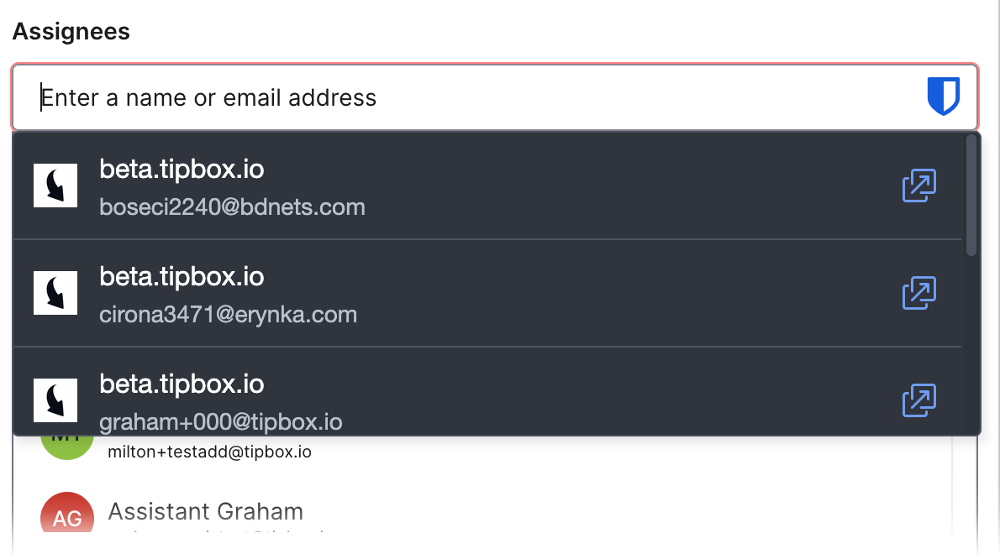

I've been working for years on apps with fields like Assignees, where you enter an email address to look up another user, not to sign in. I can't believe I didn't know about these data attributes that can 'mute' password managers on those inputs 🤦‍♂️

<figure>



<figcaption style="text-align: right; font-size: 0.85em;">I've been living like this</figcaption>
</figure>

```tsx
   // Plain HTML uses autocomplete; JSX uses autoComplete
   autoComplete="off"
   data-bwignore="true"  // Bitwarden
   data-1p-ignore="true" // 1Password
   data-lpignore="true"  // LastPass
```

## References

- [MDN: The HTML `autocomplete` attribute](https://developer.mozilla.org/en-US/docs/Web/HTML/Reference/Attributes/autocomplete)
- [1Password](https://developer.1password.com/docs/web/compatible-website-design/)
- [Bitwarden](https://github.com/bitwarden/clients/blob/main/apps/browser/src/autofill/services/collect-autofill-content.service.ts)
