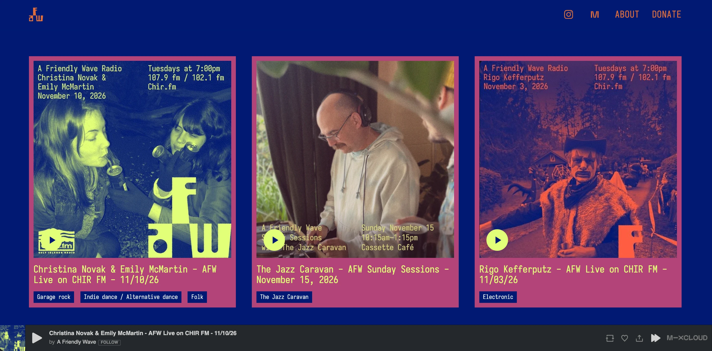

---
{
  "id": "afw-image-tool",
  "title": "A Friendly Wave - Image Tool",
  "summary": "A browser-only tool for making branded radio show artwork for A Friendly Wave.",
  "category": "portfolio",
  "order": 1,
  "publishedAt": "2026-11-17",
  "tooling": ["React", "TypeScript", "Tailwind CSS", "Canvas API", "Vite"],
  "screenshot": "./assets/afw-image-tool.webp",
  "screenshotAlt": "AFW Image Tool with a cropped, copper-dithered portrait and controls for show details, colours and image effects.",
  "url": "https://image-tool.afriendlywave.com",
  "repo": "https://github.com/GVPproj/afw-img-tool",
}
---

Turns a photo into branded artwork for A Friendly Wave's radio shows: crop to square or 4:5, add logos and show details, apply duotone or diffusion dithering using WASM, and download a PNG. Built with React, TypeScript and the Canvas API; all processing is local in the browser.

This is how we make the show images for [our website](https://afriendlywave.com/) and Mixcloud!

