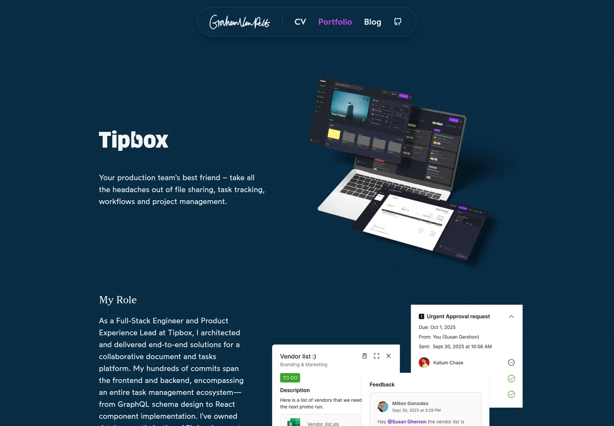
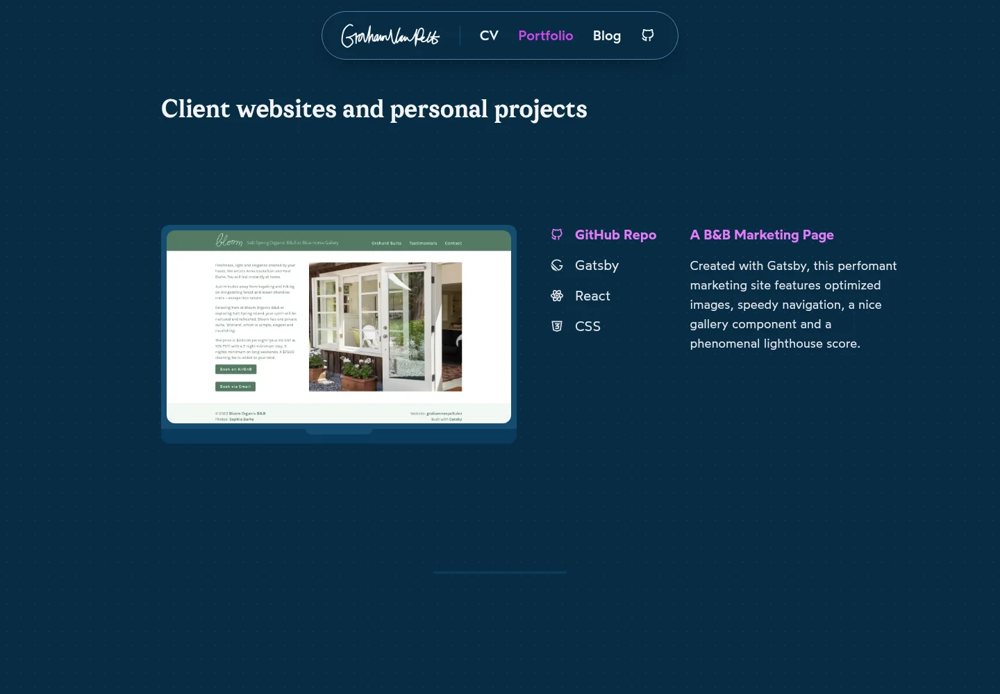
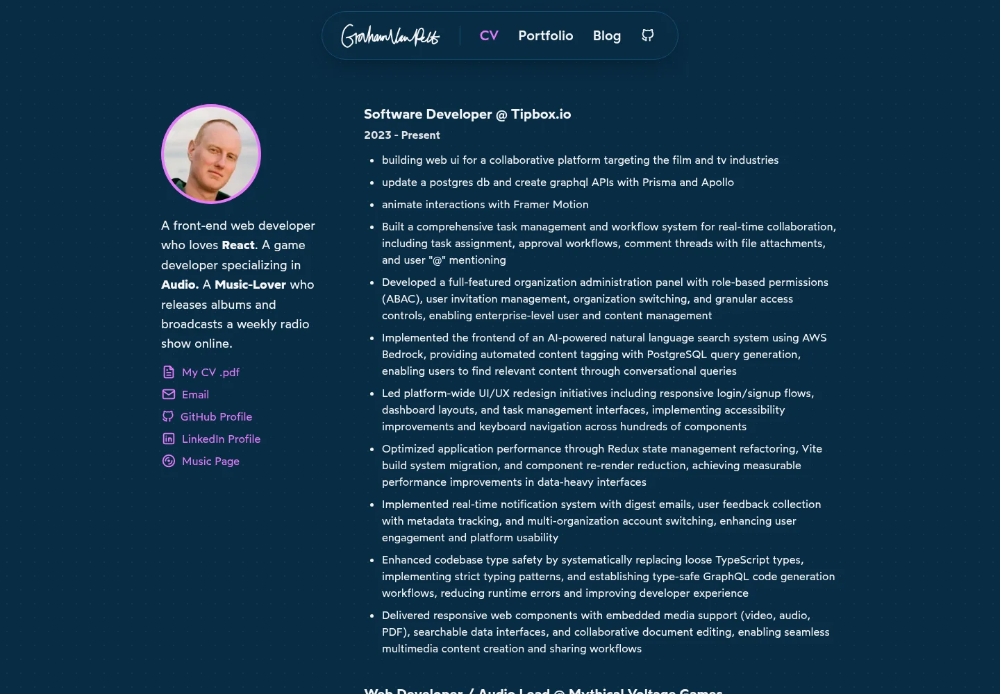

---
{
  "id": "grahamvanpelt-dev",
  "title": "grahamvanpelt.dev (old site)",
  "summary": "My old portfolio site.",
  "category": "websites",
  "order": 5,
  "publishedAt": "2026-11-17",
  "tooling": [],
  "screenshot": "./assets/grahamvanpelt-dev.webp",
  "screenshotAlt": "Graham Van Pelt’s old portfolio homepage with a dark blue background, pink text and a white line-art portrait",
  "url": "https://grahamvanpelt.dev/",
  "repo": "https://github.com/GVPproj/grahamvanpelt.dev",
}
---

My old portfolio site, showcasing my software projects, CV and blog.

## Portfolio

## CV

